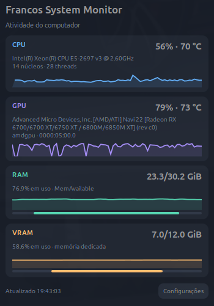
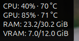

# Francos System Monitor

[](https://github.com/FrancosCorporation/status_engine_linux/actions/workflows/ci.yml)


Monitor de hardware compacto para **GNOME Shell 50 e Ubuntu Dock**, com coletor nativo em C, temperaturas de CPU/GPU e uso de RAM/VRAM em tempo real.

Um único ícone reúne os quatro indicadores na dock. Passe o mouse para acompanhar o resumo atualizado, ou clique para abrir o dashboard. O coletor continua ativo quando o painel está fechado.

<table>
<tr>
<th>Dashboard compacto</th>
<th>Resumo ao passar o mouse</th>
</tr>
<tr>
<td></td>
<td></td>
</tr>
</table>

As capturas mostram o aplicativo em execução. A capa é uma ilustração gerada por IA. A origem dos arquivos e o prompt estão documentados no [guia das imagens](docs/images/README.md).

## Recursos

- Ícone compacto com quatro barras ou minigráficos e cores configuráveis.
- Resumo atualizado enquanto o ponteiro permanece sobre o ícone.
- Painel de aproximadamente 384 × 535 px, com históricos de até 90 amostras.
- Fechamento por segundo clique, Esc ou clique fora.
- CPU por diferença de `/proc/stat` e RAM por `MemTotal - MemAvailable`.
- Descoberta de GPUs AMD por PCI, atividade real e memória dedicada via sysfs.
- Temperatura do pacote da CPU e sensor edge da GPU selecionada.
- Atualização padrão de 1 segundo, ajustável entre 0,5 e 30 segundos.
- Preferências GTK4 para métricas, cores, aparência, transparência, históricos e alertas opcionais.
- Instalação por usuário, favorito na dock e serviço de sessão gráfica.

## Compatibilidade

| Componente | Situação |
|---|---|
| Ubuntu 26.04.1 e GNOME Shell 50.1 | Validados em Wayland |
| Ubuntu Dock | Integração gráfica validada |
| Dash to Dock | Adaptador usa DockAppIcon, requer validação na instalação alvo |
| CPU Intel coretemp | Temperatura validada |
| CPU AMD k10temp/zenpower | Detecção implementada, validação física pendente |
| GPU AMD com amdgpu | Atividade, VRAM e temperatura validadas |
| Várias GPUs | Seleção implementada, validação física pendente |
| NVIDIA, Intel GPU, KDE e outras versões do GNOME | Fora da compatibilidade desta versão |

A extensão declara suporte ao GNOME 50. Os nomes das GPUs preservam a identificação fornecida pelo sistema. Sensores indisponíveis aparecem como indisponíveis na interface.

## Instalar

Use uma sessão GNOME Shell 50 com Ubuntu Dock habilitada e configurada na posição inferior. No Ubuntu, instale as dependências.

```sh
sudo apt install build-essential python3 python3-gi gir1.2-gtk-4.0 libjson-c5 pciutils

git clone https://github.com/FrancosCorporation/status_engine_linux.git
cd status_engine_linux
make install
```

O instalador compila o coletor e instala os arquivos na conta atual. O Python do sistema executa as preferências e o instalador.

Na primeira instalação, encerre a sessão e entre novamente para o GNOME descobrir a extensão. O serviço de coleta, o favorito da dock e a extensão ficam configurados para a sessão gráfica. O início automático em um novo login ainda precisa de validação adicional em outras máquinas.

Para remover a integração, execute no diretório do projeto.

```sh
make uninstall
```

As preferências pessoais permanecem em `~/.config/francos-system-monitor/settings.json`.

## Usar

Passe o mouse sobre o ícone para ver os valores atualizando. Clique para abrir o dashboard e use **Configurações** para ajustar o intervalo, indicadores e aparência.

O coletor é instalado em `~/.local/bin/francos-collector`. A extensão e as preferências ficam em `~/.local/share/gnome-shell/extensions/francos-monitor@francos.local/`. O serviço é gerenciado pelo systemd do usuário.

```sh
systemctl --user status francos-system-monitor.service
journalctl --user -u francos-system-monitor.service
```

## Compilar e testar

```sh
make build
make check
```

Os 13 testes automatizados usam fixtures para verificar cálculo de CPU, MemAvailable, sensores ausentes, GPU card1, VRAM, temperaturas, configurações, histórico, instância única e encerramento. Eles executam em CI sem uma sessão gráfica.

O procedimento de testes manuais, os resultados gráficos e a medição de recursos estão em [docs/TESTING.md](docs/TESTING.md).

## Arquitetura e desempenho

O coletor C lê `/proc` e sysfs, mantém o histórico limitado e publica snapshots JSON por substituição atômica no diretório de runtime do usuário. A extensão GJS recebe notificações assíncronas de arquivo e atualiza os elementos visíveis. Os gráficos do painel são desenhados enquanto ele está aberto. As preferências GTK4/Python são executadas sob demanda.

Na máquina de validação, o coletor apresentou aproximadamente **2,6 MiB de RSS e 0,10% de um núcleo** durante uma medição de 30 segundos. O custo adicional da interface no processo compartilhado do GNOME Shell ainda precisa de medição isolada. Esses valores descrevem uma observação local.

| Diretório | Responsabilidade |
|---|---|
| `src/collector.c` | Coleta nativa de produção |
| `src/collector.py` | Configurações, descoberta usada nas preferências e referência dos testes |
| `src/preferences.py` | Preferências GTK4 |
| `extension/` | Ícone, tooltip e painel GJS |
| `tests/` | Testes automatizados e ferramentas de validação na sessão |
| `vendor/json-c/` | Headers e avisos de licença do json-c |
| `docs/` | Documentação e referências visuais |

## Contribuir e licença

Veja [CONTRIBUTING.md](CONTRIBUTING.md) para preparar alterações e relatar problemas. O projeto usa a [licença MIT](LICENSE). Os headers de terceiros mantêm seus avisos em [vendor/json-c/COPYRIGHT](vendor/json-c/COPYRIGHT).
